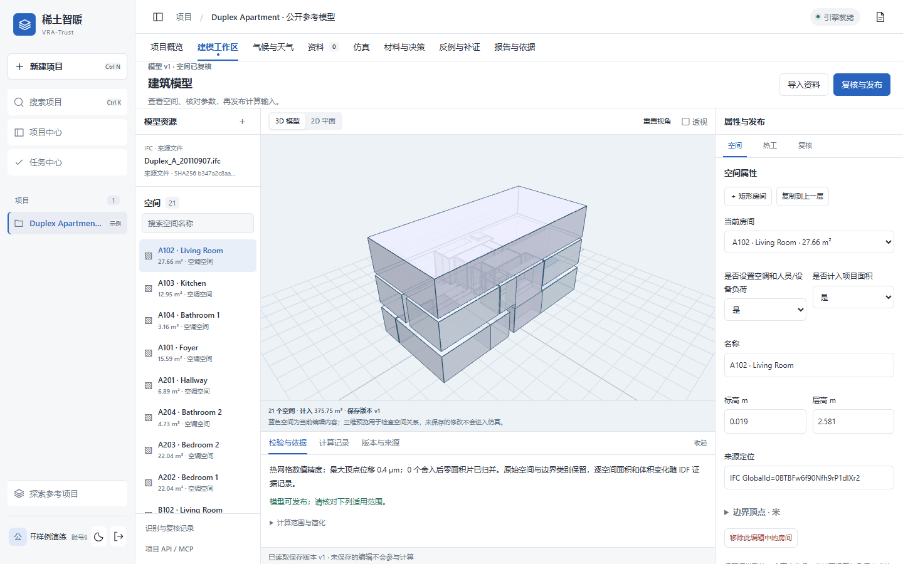

# 稀土智暖 · VRA-Trust

### 既有公共建筑节能改造的工程决策工作台

把分散的图纸、气象、材料和计算结果，组织成可以复核的改造方案。帮助工程师看清**已有依据、关键假设、方案取舍和下一步该补什么资料**。

**工程预览版 · Windows 本机部署 · 工程师复核后使用**

[开始使用](docs/QUICKSTART.md) · [功能与适用范围](#能完成什么) · [工程化路线](docs/PRODUCT_READINESS.md) · [文档中心](docs/README.md)



*真实界面截图，使用公开 Duplex 参考空间。热工与用途等属于测试假设，图示不代表实际建筑验证。来源与署名见 [截图说明](docs/assets/product/README.md)。*

## 为谁解决什么问题

适用于既有公共建筑改造前期的节能咨询、暖通与建筑性能研究，以及材料应用验证。项目资料不完整时，先整理来源与缺口，再建立可检查的模型、比较有依据的方案，形成工程讨论和补证材料。

目前适合工程师主持的受控试点。复杂项目独立交付、实际节能量认定和正式节能审查仍需进一步验证；完整差距与验收条件见 [产品就绪度评估](docs/PRODUCT_READINESS.md)。

## 能完成什么

|工作环节|你可以做什么|得到什么|
|---|---|---|
|项目资料整理|批量拖入图纸、模型、天气等文件，核对自动提取的字段、冲突和缺项|保留原件、定位、修订与待复核状态的资料清单|
|图纸与空间建模|解析 IFC、DXF、矢量 PDF；标定扫描图并复核识别候选；检查 3D/2D、空间目录和属性|可追溯到输入文件的空间模型与几何校验记录|
|气候与天气|分析 EPW 完整性、气温、辐射与度日；获取 NASA POWER 日数据用于背景分析|来源明确的气候图表、质量诊断与 CSV|
|热模型与仿真|核对构造、负荷、时段与边界，生成 IDF，排队运行实际 EnergyPlus|原生 SQL/ERR 支撑的结果、输入快照及运行记录|
|材料与方案比较|登记材料参数及检测依据，比较限定材料层、厚度和有来源的增量初始造价|能耗、舒适性、造价和运行碳排的候选取舍|
|工程助手与证据|查询项目状态、执行授权计划、定位依据；资料变更后重新核验受影响结果|持久任务时间线、补证待办、JSON/HTML/PDF 与原始证据包|
|账号与后台|管理成员、数据库、任务、AI/API、OIDC 与 SMTP；按账号启用 MFA、绑定恢复邮箱|独立 `/admin` 管理后台、会话与项目访问控制|

### 一条完整的工作流

**导入资料 → 核对缺项 → 复核空间与热工 → 检查计算准入 → 运行基准与候选 → 对比并导出依据**

识别结果先作为候选保存；缺失参数可以待补齐。关键输入未经确认、模型校验失败、原件损坏或结果已经失效时，系统保留原因并阻止使用确定结果。工程师可以回到来源修订，再生成新版本。

## 使用前需要知道

- **建模有范围。** 当前支持水平分段空间，单模型最多 100 个空间；缺少 IfcSpace 的构件模型、斜面、完整源窗转译和超范围全楼拼接仍有缺口。DWG 须先导出 DXF。任意图纸一键生成完整工程热模型尚未实现。
- **计算口径要一致。** 理想负荷给出冷热需求；PTHP 是限定的逐房间空气源热泵情景。源建筑设备曲线、水系统、管网与现场运行还原并未全面覆盖。两类结果不能直接混作设备耗电比较。
- **工程收益需要实证。** 当前没有客户建筑的账单校准或稀土材料现场节能证据；材料卡不能自动证明稀土性能优势。当前造价比较不包含完整生命周期现金流。
- **AI 负责辅助。** 正式指标来自工程工具；助手的文字说明仍需核对。复杂自由任务的可靠性尚未达到独立工程交付要求。
- **部署为本机预览。** 企业身份及邮件连接需管理员配置；公网、团队协作与生产容量仍待验收。原生密码库保存、重开填充及密码更新仍待手动复验。

## 开始使用

需要 **Windows、Python 3.12、Node.js 22.12+ 或 24，以及 EnergyPlus 9.0.1**。当前功能预览在 `feature/ai-building-workbench` 分支，经 [PR #3](https://github.com/wt009916-ship-it/VRA-trust/pull/3) 交付。

```powershell
git clone --branch feature/ai-building-workbench https://github.com/wt009916-ship-it/VRA-trust.git
cd VRA-trust
./Setup.ps1
./Start.ps1 -Port 8767 -EnergyPlusPath 'C:/EnergyPlusV9-0-1/energyplus.exe'
```

将示例引擎路径换成自己的安装位置，然后访问 **http://127.0.0.1:8767/**。启动脚本默认端口为 8766，上述命令显式指定 8767。已有本机实例时直接打开其地址，多个实例须分别使用独立端口和数据目录。

首次访问创建管理员；后续成员通过管理员邀请加入。新用户名须包含字母，新密码为 15–128 个字符，没有默认账密。管理员可在 `/admin#services` 配置 AI、OIDC 和邮件服务；普通用户在「账号设置」管理 MFA、恢复邮箱和会话。

第一次建议用随仓库提供的 [两房间教学资料](examples/building-workbench/README.md) 或显式选择参考项目熟悉流程，再换成授权项目资料。[完整操作、必备资料与常见阻断处理](docs/QUICKSTART.md)。

## 验证到哪一步

已有公开输入和实际引擎验收：原始 Duplex 的 21 个空间、Esplanades 首层的 50 个空间，以及其他限定参考情景，完成了真实全年计算；五份 EPW 的逐时字段与独立解析器对照。最新本机负载实测最高 22 并发、4,024 次请求，业务失败 0。

新增6份公开建筑IFC整模本轮均未通过，其中3份的明确楼层范围完成365天、零Warning的假设情景。真实高楼De Zalmhaven IFC含64个楼层对象，但缺少IfcSpace，无法生成热模型；台北101的RWIND风模型格式也尚不支持。[多样本与复杂高楼实测](docs/MULTI_PROJECT_ACCEPTANCE.md)完整保留成功、失败、原件哈希和本轮预检修复。

这些结果证明限定流程、封装与部分可靠性，不代表实际建筑预测精度、稀土节能率、商业竞品优势或生产 SLA。测试次数、假设、失败和原始来源见 [验证证据导航](docs/README.md#验证与适用范围)。

## 集成与资料安全

提供受项目权限限制的 HTTP API、项目 Token 和 MCP 适配器，可接入外部智能体。数据保存在部署者控制的本机运行目录；使用外部 AI Provider 时，相关结构化上下文和问题会发送到所配置的服务，使用前须核对项目授权与数据要求。详见 [开发与集成](docs/DEVELOPMENT.md)。

## 文档与反馈

- [操作指南](docs/QUICKSTART.md)：从第一次启动到导入、复核和导出。
- [工程化路线](docs/PRODUCT_READINESS.md)：距离工程师独立交付还缺什么，以及每阶段的验收门槛。
- [文档中心](docs/README.md)：产品使用、验证报告、部署和 API。
- [版本记录](CHANGELOG.md)：功能演进与对应验收文档。
- [提交问题](https://github.com/wt009916-ship-it/VRA-trust/issues/new)：请提供操作步骤、版本、错误信息和脱敏截图；不要公开项目原图、账单、密码、密钥或数据库。

## 许可与发行

项目整体授权方案尚未在顶层 LICENSE 声明；公开源码不代表已授予任意再分发或商用集成许可。依赖和样例各有许可证，见 [第三方声明](third_party_notices/) 与 [依赖清单](DEPENDENCY_INVENTORY.json)。Honeybee/Ladybug 等包含 AGPL 组件，商业发行前仍需完成整体许可方案、归属与数据授权核对。
