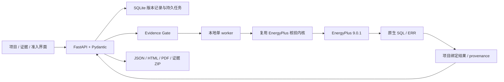

# 稀土智暖 VRA-Trust

既有公共建筑可核验节能改造决策智能体。核心原则：可复核、可拒答、可补证、可重放。

**内嵌管理后台**：`/admin` 现提供账号与密码、数据库管理、AI/API 配置、任务与审计四页。可新增/编辑成员、重置成员密码、搜索分页查询业务记录及历史、校验和备份数据库。[使用与验收记录](docs/ADMIN_DATABASE_CONSOLE.md)。

**2026-10-24：图纸建模与热模型实测**。本地扫描图标定/墙线识别、DXF 块与曲线、IFC 有依据的 FootPrint 重建、Honeybee 独立几何检查、逐时新风/热回收、原生定容热泵耗电已接入。公开 PDF 和 Duplex 共 9 组全年情景完成；仍有明确的源图/几何/设备限制。新增 Honeybee/Ladybug 为 **AGPL-3.0**，商业发行许可尚不能视为已解决。[功能、实际结果、失败与复跑说明](docs/DRAWING_THERMAL_ACCEPTANCE.md)。

**2026-10-23：资料收件箱与独立后台**。首页拖入多份项目资料，自动分类、提取明确字段并标出冲突和缺项；确认后归档待审证据，EPW 自动分析，IFC/DXF 自动进入候选识别。`/admin` 管理成员、邀请码、模型 API 和运行记录；默认邀请注册，支持账号停用与修改密码。具体功能、开源选型、真实输入结果和限制见 [本次改造说明](docs/PROJECT_INTAKE_ADMIN.md)。

**2026-10-21：天气分析与工作台更新**。已接入 NASA POWER 公开日气象获取、月图／度日／CSV、EPW 质量检查与仿真准入；更新项目概览、登录、深色和窄屏界面。新增天气 Agent/MCP 工具（当前 26 / 9 个）。真实数据、原生全年计算验收及适用范围见 [天气工作台](docs/WEATHER_WORKSPACE.md)。

**2026-10-23：本地扫描件识别与校正**。拖入扫描 PDF、图片或混合 PDF，可自动识别文字、预填明确项目字段；对照原图校正后保留修订历史并归档。安装依赖时随 RapidOCR 安装本地模型，处理文档不依赖外部 API。[实际测试与使用限制](docs/DOCUMENT_OCR.md)。

**2026-10-20：建模与智能体集成版**。DXF / 矢量 PDF / IFC 实际解析、扫描图视觉接口、LangGraph 持久复核、三维空间编辑、分层热工构造、IDF 生成和真实 EnergyPlus 计算已贯通；新增项目 API Token 与八个 MCP 工具。使用方法、开源组件和工程边界见 [建模工作区](docs/BUILDING_WORKBENCH.md)。

发布包含已构建前端：Python 3.12 下执行 `./Setup.ps1`，再执行 `./Start.ps1 -EnergyPlusPath <energyplus.exe绝对路径>`。下面也保留源码开发方式。

**新增“材料与决策”工作区**：项目诊断与补证待办 → 有来源的材料卡 → EnergyPlus 真实材料方案比较 → 目标/约束与非支配候选 → 助手执行及同源工程报告。支持能耗、增量造价、舒适性和运行碳排取舍，材料与证据变化后重新核验。使用方法和验收范围见 [核心功能升级](docs/CORE_DECISION_UPGRADE.md)。

当前已在 Phase 0/1 基础上接入节点追溯、碳因子选择性重算、受控工具执行与 DeepSeek Adapter、有限域真实仿真搜索，以及人工确认到简单三维的闭环。**这仍不是全部模块或生产环境验收完成。** 详见 docs/TRUST_AGENT_SPATIAL_DELIVERY.md。

可靠性优化：断线后自动重连并重新核验结果，导入重试复用已上传文件，搜索域可关联已复核证据并随其版本变化失效。变更、验证结果与限制见 [可靠性更新](docs/RELIABILITY_UPDATE.md)。

## 启动

最新增量：真实账号与项目隔离，以及项目侧栏、中央任务区、独立工作视图和右侧详情。见 docs/ACCOUNT_WORKSPACE_UPDATE.md。

需要 Python 3.12、Node 22+ 和 EnergyPlus 9.0.1。

```powershell
python -m venv .venv
.venv/Scripts/python -m pip install -r backend/requirements-dev.txt
cd frontend
npm ci
npm run build
cd ..
$env:ENERGYPLUS_EXE = 'F:/EnergyPlusV9-0-1/energyplus.exe'
./Start.ps1
```

访问 http://127.0.0.1:8766 。本机任务也支持已有的 vra-venv 开发环境。Start.ps1 仅监听本机，不自动安装依赖。

首次访问初始化管理员（用户名 3–32 位且包含字母；新密码至少 12 位，包含字母与符号）。后续成员默认通过 `/admin` 生成的一次性邀请码注册。无默认密码；既有项目归入首个账号，其他账号只能访问自己的项目。账号数据库保存在 runtime，不得提交或公开。当前暂无邮件找回。

1. 拖入多份项目文件，先自动整理资料；核对提取结果、补齐缺项后建立项目。没有文件时也可手动登记。
2. 在各专项工作区查看真实提取与分析结果；在资料详情完善来源与许可，保存修订历史。参考模型必须显式选择，不能混作实际项目。
3. 人工核对并确认模型/天气；输入不唯一、未确认或文件损坏时 Gate 拒绝计算。
4. 运行 baseline/R1/R2，查看真实任务状态、能耗、EUI、运行 CO2、Warnings 和 SQL 定位。
5. 查看依据，下载 JSON/HTML/PDF/原始证据 ZIP。证据变更使受影响结果失效，确定推荐保持拒答。
6. 进入“材料与决策”，登记并复核材料，选择实际构造层、候选厚度、造价来源与工程约束，直接运行或让助手执行计划，再查看候选取舍和报告。

参考模型不是实际建筑。基准已有保温，追加保温参数是教学假设；碳情景不是正式地区核算或 CCER。

## 验证

```powershell
.venv/Scripts/python scripts/verify.py --engine
.venv/Scripts/python scripts/replay.py runtime/runs/run_<实际ID>
```

verify --engine 创建新的真实运行；日志在 validation/final，API 验收在 validation/phase1。最后会故意撤回基准证据确认，以验证 stale 拒答。失败和旧记录保留。
不带 --engine 时只跑代码检查/测试/构建；若本地已有旧原生运行且代码变更，原生版本检查可能要求重新运行参考算例。

## 架构



物理能耗由 EnergyPlus 产生。建模工作区可从复核后的空间与参数生成理想负荷 IDF；通用建筑声明仍用于核对模型。节点图区分证据版本、仿真、能耗、面积、EUI、因子和碳排；改变因子仅重算碳排，原仿真保持不变。

## 资料导航

- docs/BUILDING_WORKBENCH.md：本次多格式建模、开发者 API、MCP、真实引擎集成与限制。
- docs/CURRENT_STATE_AUDIT.md：修改前真实状态及原包依据。
- docs/IMPLEMENTATION_STATUS.md：当前完成度、阻塞和下一步。
- docs/CORE_DECISION_UPGRADE.md：诊断、材料验证、真实方案比较与助手执行的使用步骤和验收。
- docs/ROUND1_DELIVERY.md：本轮架构、变更、验收、未实现项。
- docs/API_CONTRACT.md / shared/schemas：契约及 OpenAPI。
- docs/REPLAY.md：可复算边界。
- docs/OPEN_MODELS.md：公开模型来源及许可。
- docs/DEPLOYMENT.md：本地 / Docker / 阿里云阶段边界。
- docs/PHASE_BACKLOG.md：拟同步 GitHub 的分阶段 Issues。
- AGENTS.md / .agents/skills/vra-trust：后续开发上下文。

## 保留与隔离

frontend/legacy 保存原 Three.js/图表/适配/报告源码。fixtures/demo 保存历史 JSON 与官方参考输入，活动前端不读取历史结果。
legacy/backend_submission 和 research/original_guo 在本机保留，因原始交付/研究资料未经公开整理，不纳入 Git。原始压缩包与上一版目录均未修改。
runtime、runs、validation、密钥、依赖和私人建筑资料不提交。

## 发布状态

本地会话和项目授权已验证；团队共享、邮件找回和公网部署未完成。HTTPS 部署必须设置 VRA_COOKIE_SECURE=true，另行配置域名/TLS/代理。Docker Compose 为准备配置，未运行容器；阿里云和第二台电脑验收按用户最新指示暂缓。项目源码已上传 GitHub；后续增量通过功能分支与 PR 交付，远程校验以各 PR 的 CI 为准。


## 新增入口

- 首页嵌入八步工作流动画，可暂停和逐步切换，明确标记为流程示意。
- 首个管理员账号：侧栏 **开发者设置** → 填写服务 endpoint / Key / 文本与视觉模型 → 保存 → 测试连接。Key 不进入前端构建或浏览器存储。
- 项目工作台：选择“本地工程流程”或“AI Provider”，观察真实工具与 Provider 请求时间线；工程结果仍来自工具。
- 仿真页：修改碳因子 → 观察 Carbon STALE → 仅重算碳排。
- 反例与补证：填写共同材料导热系数离散点、来源与预算 → 真实仿真 → 条件补证成本候选排序。
- 建模工作区：导入图纸或 IFC，复核候选与比例，编辑空间和构造，发布 IDF 并提交真实仿真。

运行专项真实验收：`python scripts/verify_trust_slice.py`。它在 validation 下建立隔离账户，运行 3 个参考方案和 3 次预算内反例仿真，并核验选择性重算不调用 EnergyPlus。

Provider 协议依据：[DeepSeek 官方 Tool Calls 文档](https://api-docs.deepseek.com/guides/tool_calls/)。默认模型 deepseek-flash，可在管理员设置中修改。未填 Key 时不会模拟 LLM 成功；协议测试不等于付费服务商在线验收。
