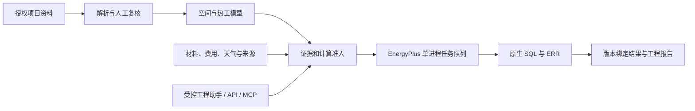

# 开发与集成

操作见 [开始使用](QUICKSTART.md)，工程边界见 [就绪度评估](PRODUCT_READINESS.md)。本页面向维护者和集成者。

## 本机开发

```powershell
./Setup.ps1 -Development
npm --prefix frontend ci
npm --prefix frontend run build
./Start.ps1 -Port 8767 -EnergyPlusPath 'C:/EnergyPlusV9-0-1/energyplus.exe'
```

源码更新后重新安装依赖并构建前端。`Setup.ps1` 在已有 dist 时不会主动重建；上面保留显式构建步骤。`Start.ps1` 不执行 `.env` 文本，请用进程环境或启动参数设置配置，参阅 [.env.example](../.env.example)。

## 结构与数据边界



- `frontend/src` 为活动前端；`backend/api.py` 管理同源 API、身份与项目边界。
- `modeling.py`、`model_import.py`、`model_export.py` 负责持久候选复核与确定性转换。
- `core.py`、`domain.py` 负责引擎、原生输出核验、版本与任务。
- `materials.py`、`decision.py` 负责材料证据与限定候选比较。
- `auth.py`、`identity_*.py` 负责账号、会话、MFA、OIDC 和邮件恢复。
- SQLite 保存账号、版本和任务，运行目录保留原件与结果，不属于 Git 源码。`frontend/legacy` 和 `legacy` 为归档。

队列与计算信号量依赖单服务进程，保持 `--workers 1`。验收、负载与恢复使用独立数据目录，不操作正式账号和项目。

## API 与 MCP

运行后 `/openapi.json` 和 [shared/schemas](../shared/schemas/) 为契约入口，详见 [API 文档](API_CONTRACT.md)。业务路由与下载校验会话/项目归属，浏览器写请求还须 CSRF。

项目工作区「项目 API / MCP」可创建有限范围/有效期的 Token，原始值仅显示一次。外部客户端通过 HTTP 或 `scripts/run_mcp.py` 接入；MCP 不直接访问数据库。计算须 compute 权限、显式确认和工程准入同时通过。连接示例见 [建模工作区](BUILDING_WORKBENCH.md)。

Provider 从 `/admin#services` 配置。外部服务会接收相关结构化上下文与用户问题，不能据“原件未自动上传”宣称整个 AI 流程完全离线。服务、模型和数据授权由部署者核对，Key 在后台或秘密管理器提供。

## 检查

```powershell
.venv/Scripts/python.exe -m ruff check backend tests scripts
.venv/Scripts/python.exe -m pytest -q
npm --prefix frontend run lint
npm --prefix frontend test
npm --prefix frontend run build
.venv/Scripts/python.exe scripts/export_contract.py
git diff --exit-code -- shared/schemas
```

缺少引擎或历史原生参考运行时，部分测试会跳过或要求准备匹配输入，必须记录实际通过/跳过/失败。代码检查不等于全年引擎验收。专项入口见 [验证导航](README.md#验证与适用范围)。

`scripts/verify.py --engine` 创建新参考运行，含故意撤回证据的失效检查；先读脚本并在隔离目录执行，不能操作客户生产数据。`scripts/replay.py` 用于已有计算记录重放，条件见 [REPLAY](REPLAY.md)。

`scripts/verify_morphology.py --output <仓库外新目录>`执行16类控制形态的IFC几何往返、独立校验及原生全年计算；`--geometry-only`不运行引擎。控制样本定义在`scripts/morphology_cases.py`。公开原件API复测使用`scripts/benchmark_new_projects.py --manifest <冻结清单> --output <新目录>`，manifest可显式指定`import_options`和`thermal_options`，运行时保留这些假设与文件哈希。不能把控制形态或显式假设情景称为客户建筑实测。

原生单次计算默认预算1800秒，`VRA_ENGINE_TIMEOUT_SECONDS`允许30–7200秒；故障注入测试可使用较短显式预算。队列超时、进程退出或仅有部分SQL不会产生全年成功。编译器哈希改变使旧物理运行保守失效；复跑创建新记录，旧manifest不更新。

## 提交与发行

功能/修复分支通过 PR 和 CI 交付。修改须说明用户行为、适用范围和验证依据；保留 `AGENTS.md` 中来源、拒答和历史规则。

运行数据、Key、数据库、个人资料、模型原包和依赖目录不得提交。截图仅用授权参考/教学输入并保留归属。当前没有已验收的一键安装器或正式签名发行流程；历史 release 脚本不作为发布入口。整体授权方案未定稿，保留各依赖原有许可证，不擅自统一改成 MIT 等协议。
